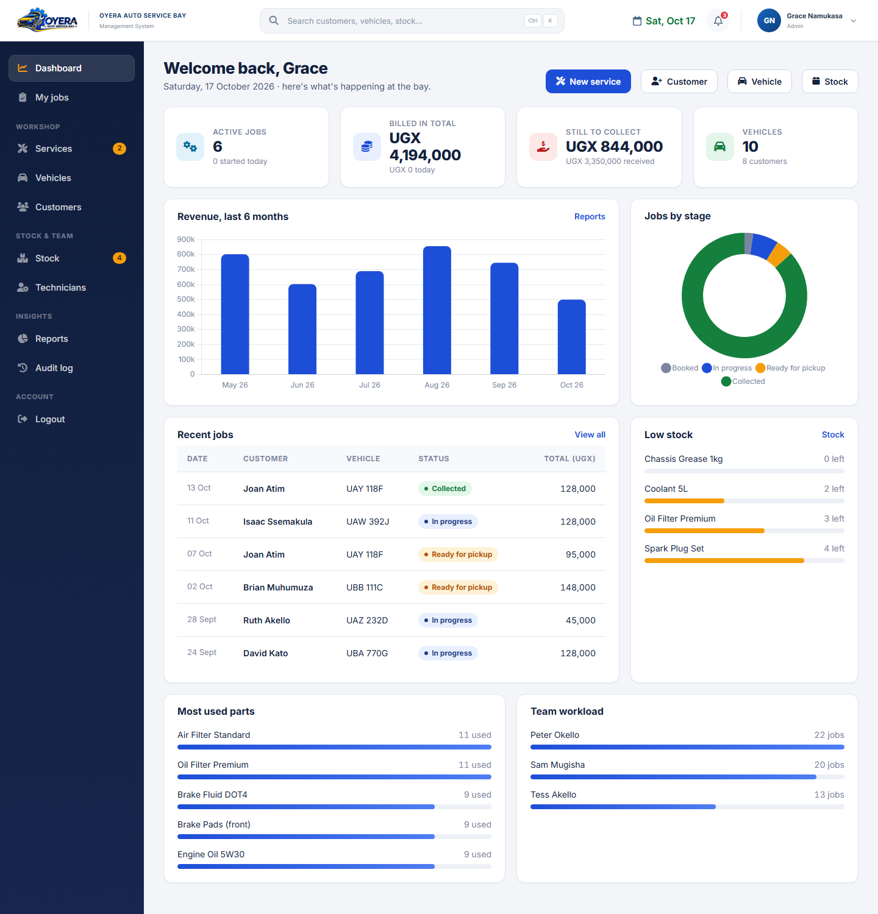
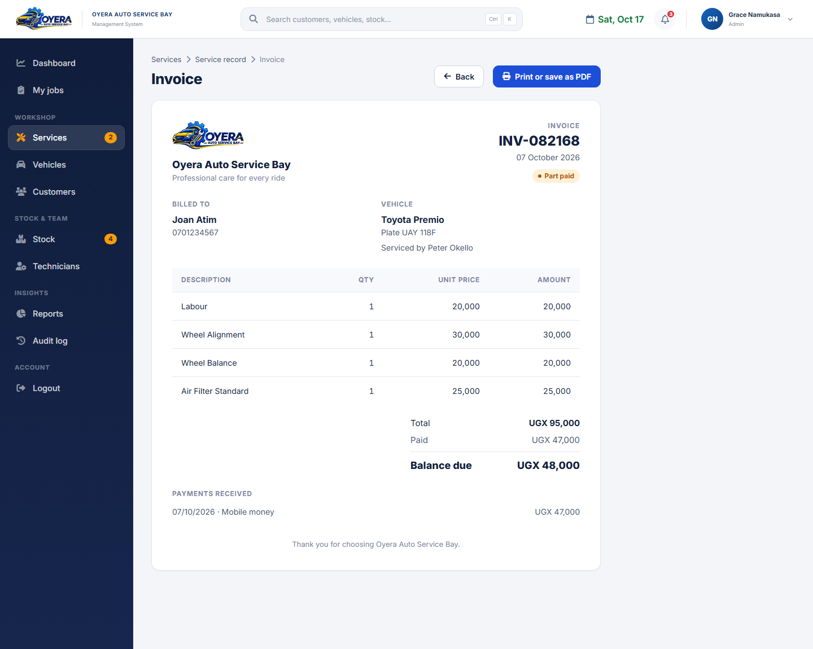

# Oyera Auto Service Bay Management System

A web application that helps an auto service garage run its day-to-day work in one place: customers, vehicles, service jobs, technicians, spare-parts stock and payments. Staff log in, record a service job, and the system prices it automatically and takes the parts used out of stock. Managers get a live dashboard and reports, and technicians see a focused view of their own jobs.

Built as my final project for the Software Engineering with JavaScript programme at Refactory Academy.



*The dashboard shows demo data for illustration.*

## The problem it solves

Many garages track jobs and parts on paper or in separate spreadsheets. That leads to wrong bills, missing stock and no clear record of who did what. Oyera brings the whole workflow into one system with clear business rules, so bills are consistent, stock stays accurate and every change is traceable.

## Features

- **Customers and vehicles:** register customers, link vehicles to their owners, and view full profiles and service history.
- **Service jobs:** record the services performed, the technicians involved and the parts used. The job is priced automatically and parts are deducted from stock.
- **Job tracking:** move each job through four stages: Booked, In progress, Ready for pickup and Collected.
- **Payments and invoices:** record partial or full payments, see the balance, and print an itemised invoice. Bills keep the prices from the time of the job, so later price changes never alter old bills.
- **Stock management:** track spare parts, quantities and reorder levels, with low-stock warnings.
- **Dashboard and reports:** revenue by month, jobs by stage, most-used parts and technician workload, plus filterable reports with CSV export.
- **Audit log:** records who did what and when (Admin only).
- **My Jobs:** technicians see their own unfinished jobs.
- **Global search:** one search box across customers, vehicles, stock, technicians and jobs.



## Roles and access

| Role | Access |
|---|---|
| **Admin** | Everything, including users, payments and the audit log |
| **Senior technician** | Manages jobs, customers and vehicles, and can export CSV reports |
| **Technician** | Sees and updates their own jobs only |

Access is enforced on the server, not only by hiding menu items.

## Security

- Passwords hashed with **bcrypt**
- Session ID regenerated at login, sessions stored in MongoDB with HTTP-only cookies
- **CSRF** tokens on every form submission
- Login **rate limiting** against repeated failed attempts
- **Helmet** security headers
- Server-side **role checks** on protected actions
- CSV exports protected against spreadsheet formula injection

## Data integrity

- **Atomic stock updates:** stock is reduced with a single conditional database operation, so two people saving at the same moment cannot take stock below zero.
- **All-or-nothing jobs:** if one part on a job is short, nothing is saved and anything already taken is put back.
- **Safe payments:** a payment cannot exceed the balance, even when two cashiers pay at the same time.
- **Delete protection:** customers, vehicles and parts that are used by existing records cannot be deleted.

## Tech stack

| Layer | Technology |
|---|---|
| Runtime | Node.js (ES modules) |
| Web framework | Express 5 |
| Views | Pug (server-rendered), Bootstrap, Chart.js |
| Database | MongoDB with Mongoose |
| Sessions | express-session with connect-mongo |
| Security | bcryptjs, helmet, express-rate-limit, CSRF middleware |
| Testing | Node's built-in test runner |

The app follows an MVC-style structure: routes call controllers, controllers call services that hold the business rules (pricing, stock, billing), and services use Mongoose models.

```
config/        pricing, business and environment settings
controllers/   request handlers
middleware/    auth, CSRF, rate limiting, error handling
models/        Mongoose schemas
routes/        URL routing
services/      business rules: pricing, stock, billing, audit
views/         Pug templates
public/        CSS, JavaScript and images
tests/         automated tests
```

## Getting started

**Requirements:** Node.js 20 or newer and a running MongoDB instance.

```bash
git clone https://github.com/nekesam/Oyera-service-bay-final-project.git
cd Oyera-service-bay-final-project
npm install
```

Create your environment file from the example and fill in your values:

```bash
cp .env.example .env
```

```
DATABASE=mongodb://localhost:27017/oyera
SESSION_SECRET=use-a-long-random-string
PORT=3000
```

Start the app:

```bash
npm start
```

Then open http://localhost:3000. For development with automatic restarts, use `npm run dev`.

**Production notes:** set `NODE_ENV=production` so cookies are marked secure, set `TRUST_PROXY=1` when running behind a reverse proxy, and use a long random `SESSION_SECRET`.

## Running the tests

```bash
npm test
```

The project has **65 automated tests** covering security, pricing, stock, payments, roles, data rules and page rendering. They include concurrency tests, for example 10 simultaneous jobs competing for 5 items, where exactly 5 succeed and stock never goes negative. The tests use their own temporary database, so they never touch your real data.

## Documentation

See [docs.md](docs.md) for the full documentation, including architecture diagrams and the data model.

## Known limitations

- The Content-Security-Policy is switched off because pages use CDN-hosted libraries and inline scripts.
- The interface needs an internet connection for the CDN libraries.
- Records are hard-deleted, and there is no refund flow yet.
- The app runs on a single server.

## Future improvements

- A React front end
- Archive instead of delete, so history is never lost
- Refunds
- Local hosting of front-end libraries with a Content-Security-Policy
- Deployment

## Author

**Martha Nekesa**, Software Engineering graduate, Refactory Academy.
GitHub: [github.com/nekesam](https://github.com/nekesam)
