# Oyera Auto Service Bay - Management System

A centralized web application that lets a garage manage its customers, vehicles,
service jobs, technicians and spare-part inventory in one place. Staff log in,
capture service jobs, and the system automatically prices the job and deducts the
parts used from stock. Managers get dashboards and reports; technicians get a
focused, permission-limited view.

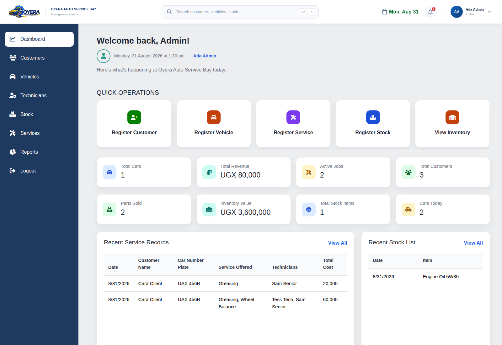

---

## 1. What the system does

| Area | Capability |
|---|---|
| **Customers** | Register customers, edit, view a full profile with their vehicles and job history |
| **Vehicles** | Register vehicles, link them to a customer, track type/status/last service |
| **Services** | Capture a service job: customer + vehicle + services performed + technicians + parts. Cost is auto-calculated and stock is deducted |
| **Stock / Inventory** | Register spare parts and oils, track quantity and unit price, low-stock awareness |
| **Technicians** | Register technicians (Technician / Senior technician), see workload and performance |
| **Users** | Admin manages system user accounts |
| **Dashboard** | Live totals: revenue, cars, active jobs, customers, parts sold, inventory value |
| **Reports** | Filterable service / vehicle / technician / inventory reports |
| **Global search** | One search box across customers, vehicles, stock, technicians and jobs |

---

## 2. Technology stack

| Layer | Choice | Why this choice |
|---|---|---|
| Runtime | **Node.js (ESM, `.mjs`)** | Native ES modules, no transpiler / build step |
| Web framework | **Express 5** | Minimal, well-understood routing and middleware model |
| Views | **Pug** server-side templates | HTML is rendered on the server - no client framework, no bundler, one thing to deploy. Fast first paint, simple mental model |
| Database | **MongoDB** + **Mongoose 9** | Schema-flexible document model fits the nested shape of a service record (arrays of services, technicians and parts inside one document). Mongoose adds schemas, validation and `populate()` for joins |
| Sessions | **express-session** + **connect-mongo** | Login state is stored in MongoDB, so it survives server restarts and can scale to more than one server instance |
| Passwords | **bcryptjs** | Hashed with a `pre('save')` hook on the User model - plain passwords never touch the database |
| Enhanced selects | **Tom Select** (via CDN) | Turns the multi-select fields into searchable, tag-style inputs without adding a build pipeline |
| Client interactivity | **Vanilla JS** (`tableSearch.js`, `cardLinks.js`) | Table filtering and clickable cards are ~50 lines each - a framework would be heavier than the feature |
| Icons / grid | Font Awesome + Bootstrap Icons + Bootstrap CSS (CDN) | Icon set and a few utility classes only |

**Guiding principle:** zero build step. `npm install` then `npm start` - no webpack, no compile, no `dist/` folder.

---

## 3. Architecture

Classic **MVC-style, server-rendered** application. Every request flows through
one pipeline; the controller is the only place that touches both the database and
the view.

### 3.1 System architecture

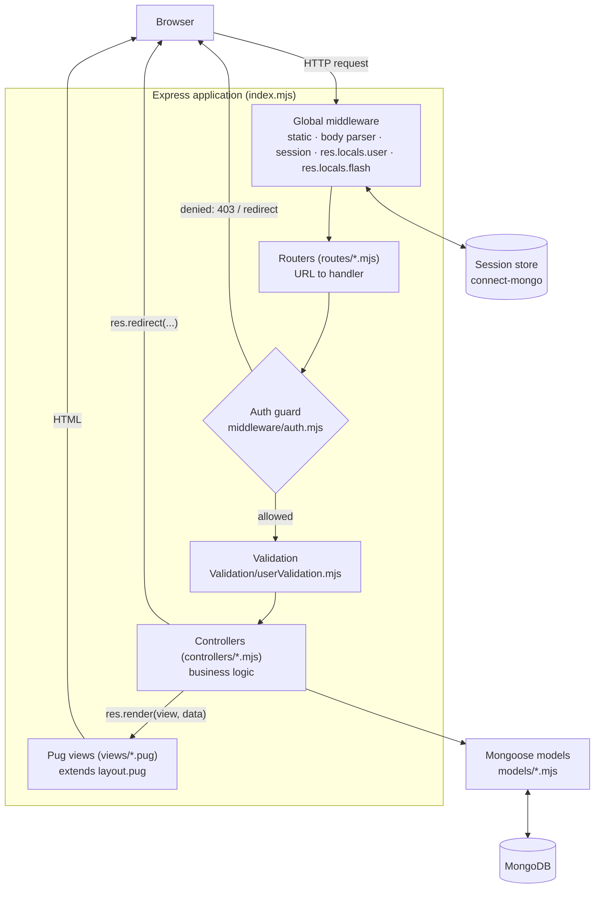

### 3.2 Request lifecycle

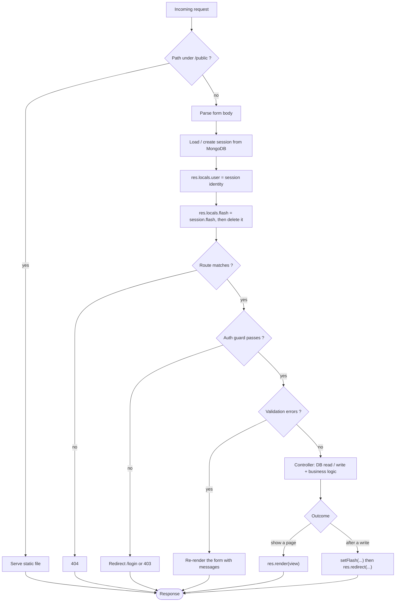

### 3.3 Folder map

```
index.mjs              app bootstrap + middleware + route mounting
db.mjs                 MongoDB connection
routes/                URL → controller wiring, one file per resource
controllers/           request handlers + business logic
models/                Mongoose schemas (User, Customers, Vehicle, Stock, ServiceRecord)
middleware/auth.mjs    role guards
Validation/            server-side input validation middleware
utils/                 passwordUtil (hash hook), flash (setFlash helper)
views/                 Pug templates; layout.pug is the shell, partials/sidebar.pug the nav
public/css             one stylesheet per page + layout.css + detail.css
public/js              dashboard.js, tableSearch.js, cardLinks.js
```

---

## 4. Data model

```
User (fullName, email|phone unique+sparse, role, passwordHash, timestamps)
  role ∈ { Admin, Senior technician, Technician }

Customers (customerId?, firstName, lastName, phone, email?, address?)

Vehicle (customerId → Customers, vehicleName, color, registrationNo,
         ownerName, vehicleType ∈ {small,commercial,heavy}, status, lastService)

Stock (stockId unique, itemName, category, supplier, quantity, unit,
       unitPrice, date, storageLocation, registeredBy → User, timestamps)

ServiceRecord
  customer      → Customers        (required)
  vehicle       → Vehicle          (required)
  servicesDone  [String]           e.g. ["Greasing", "Wheel Balance"]
  technicians   [→ User]           (required, one or more)
  partsUsed     [{ stockId → Stock, itemName, quantity }]
  labourCharge  Number  (default 20 000)
  totalCost     Number  (computed)
  date          Date    (default now)
```

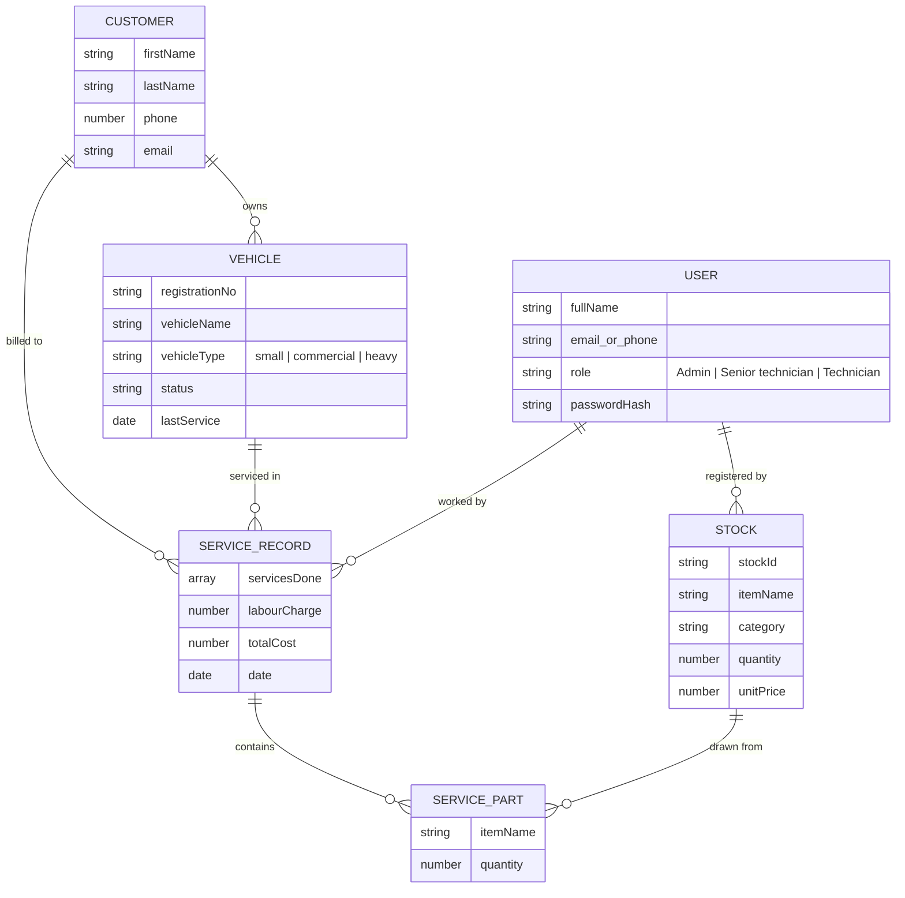

> `SERVICE_PART` is the embedded `partsUsed[]` sub-document - it is not a separate
> collection.

**Why one big `ServiceRecord` document instead of join tables:** a service job is
naturally a single unit of work - the services list, the assigned technicians and
the parts consumed all belong to that job and are always read together. MongoDB
lets that live in one document; `populate()` pulls in the referenced customer,
vehicle and technicians when the record is displayed.

---

## 5. Authentication & sessions

- **Sign-up / login** accept either an email or a Ugandan phone number as the
  identifier (`validateSignup` / `validateLogin` decide which by looking for `@`).
- Passwords are hashed by a `userSchema.pre('save')` hook (`utils/passwordUtil.mjs`)
  - the controller never sees or stores a plaintext password.
- On successful login the controller sets `req.session.userId`, `userRole` and
  `userName`. `connect-mongo` persists the session in MongoDB; the browser only
  holds an opaque session-id cookie.
- A global middleware copies the logged-in identity into `res.locals.user` so
  every template can show the name/role without the controller passing it each time.

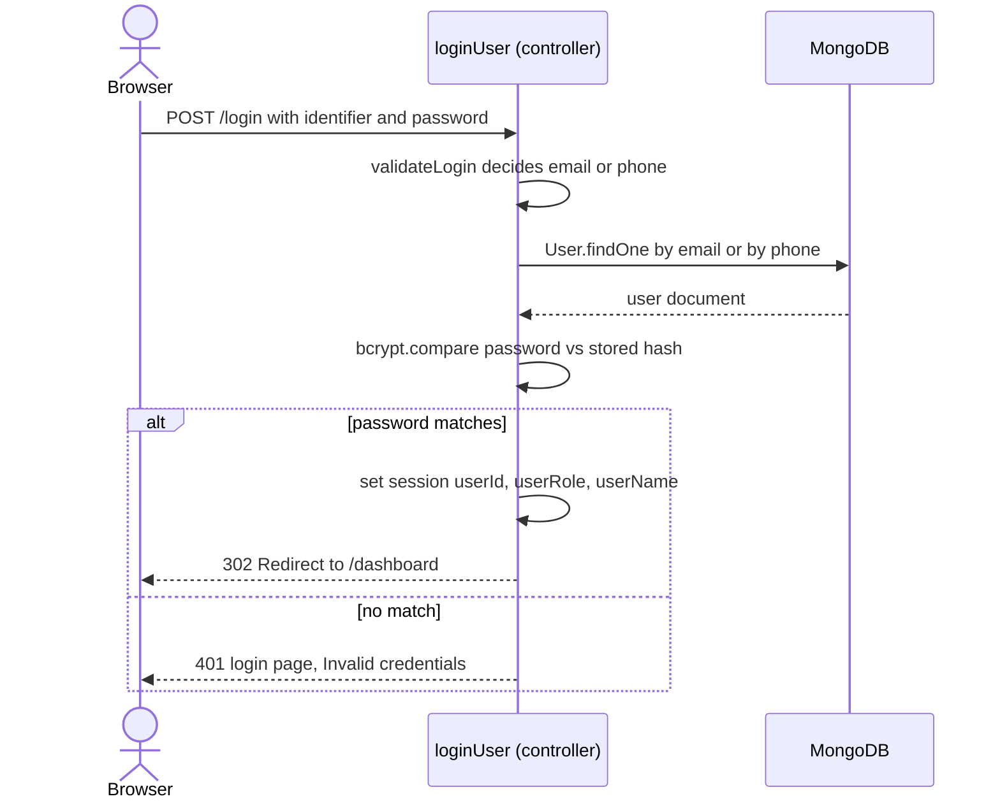

---

## 6. Roles & access control

Three roles, enforced in **two layers**:

**Layer 1, route guards** (`middleware/auth.mjs`): `isAuthenticated`,
`isAdmin`, `isSeniorTechnician`, `isAdminOrSeniorTechnician`. These sit in front
of the controller and return `403` (or redirect to `/login`) before any handler runs.

**Layer 2, UI capability flags** (`dashboardPermissionsByRole` in
`controllers/dashboardControllers.mjs`): a single object that says, per role,
which nav items, buttons and actions to render. Controllers pass the matching
flag set to the view as `permissions`.

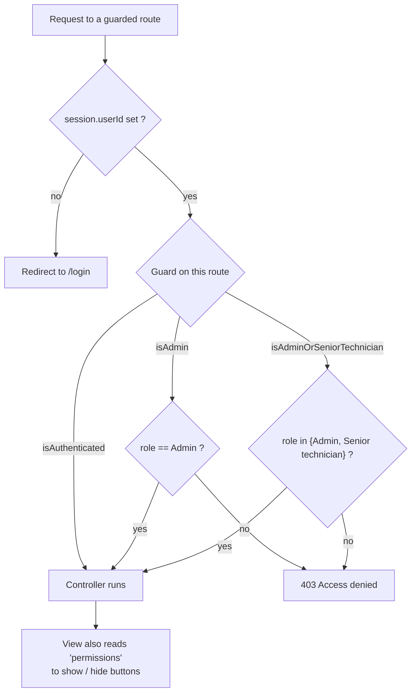

| Capability | Admin | Senior technician | Technician |
|---|:-:|:-:|:-:|
| Customers | ✅ | ✅ | - |
| Vehicles - view | ✅ | ✅ | ✅ |
| Vehicles - add / edit / delete | ✅ | ✅ | ❌ (view only) |
| Services - view | ✅ | ✅ | ✅ |
| Services - add / edit / delete | ✅ | ✅ | ✅ |
| Technicians page | ✅ | - | - |
| Inventory - view | ✅ | ✅ | ✅ |
| Inventory - add / edit / delete | ✅ | ✅ | ❌ |
| Reports | ✅ | ✅ | - |

> **Design decision:** keeping the permission matrix in one object (not scattered
> `if role ===` checks) means the rule for "can a technician edit vehicles?" is
> defined once and read by both the route layer and every template. Changing a
> rule is a one-line edit.

---

## 7. Core business logic (service costing & stock)

When a service record is created (`serviceControllers.createServiceRecord`):

1. **Validate** the customer exists and the chosen vehicle actually belongs to
   that customer.
2. **Service charge** - sum of a fixed price table (`Wheel Alignment` 30 000,
   `Wheel Balance` 20 000; other services carry no separate charge).
3. **Parts cost** - for each selected part: `unitPrice × quantity`, after a
   *price-rule* sanity check (e.g. engine oil must fall in UGX 79 000-200 000;
   a common "missing trailing zero" typo like `8 000` is auto-corrected to
   `80 000`, otherwise the value is clamped to the allowed band).
4. **Total** = `labour (20 000)` + service charge + parts cost.
5. **Stock is checked and deducted** - if any part doesn't have enough quantity,
   the whole save is rejected with a clear message.

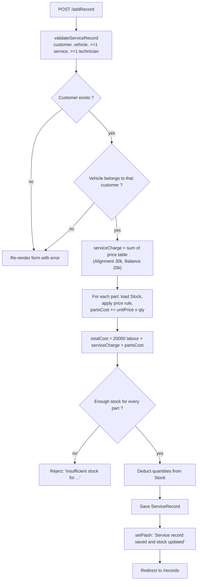

On **edit**, parts are reconciled: the previously-used quantities are added back,
then the new selection is validated and deducted. On **delete**, all parts on the
record are returned to stock. This keeps inventory correct no matter how a job is
changed after the fact.

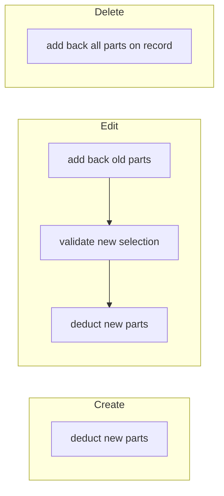

The same total is also computed live in the browser as the user fills the form,
so the "Total Cost" field updates before saving.

---

## 8. Feature walkthrough

Each item below states **what**, **how it was built**, and **why that approach**.

### 8.1 Flash messages after save

**What:** after registering/updating/deleting a customer, vehicle, service record,
stock item or technician, a green (or red) toast appears on the page you land on
and fades after a few seconds.

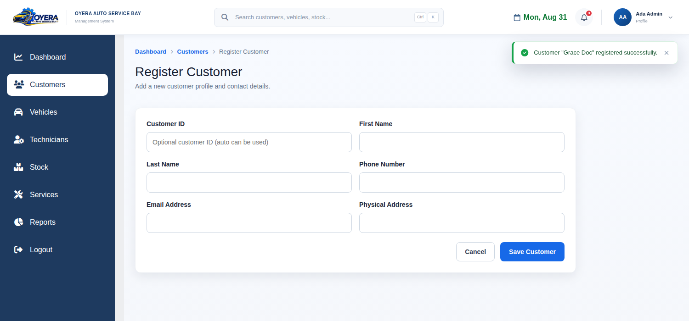

**How:** `utils/flash.mjs` exposes `setFlash(req, message, type)` which writes
`req.session.flash`. A middleware in `index.mjs` moves it to `res.locals.flash`
and deletes it from the session on the very next request, so it shows exactly
once. `layout.pug` renders it as a fixed-position toast; a tiny inline script
dismisses it.

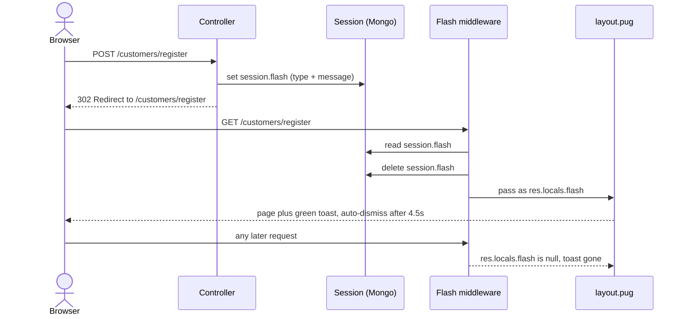

**Why:** the app already had `express-session`. Reusing it for a one-shot message
avoided adding `connect-flash` as a dependency - the whole feature is one helper,
one middleware and ~10 lines of template.

### 8.2 Record detail (View) pages

**What:** every list row now has a **View** button (next to Edit/Delete) that
opens a read-only page showing every field that was entered, plus related history
- a customer's vehicles and jobs, a vehicle's full service history, a
technician's recent assignments, a service record's parts list.

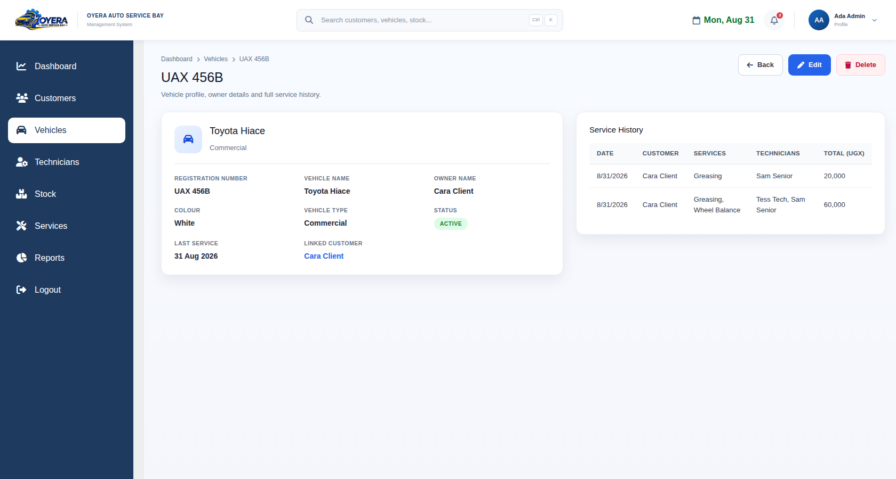
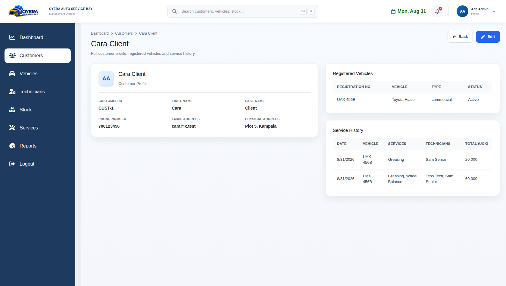

**How:** a `GET /:id` route was added to each resource router **after** the
literal routes (`/register`, `/edit/:id` …) so Express matches the specific paths
first. Each controller loads the record with `populate()` for its relations and
renders a detail view. Six new templates share one stylesheet, `detail.css`.

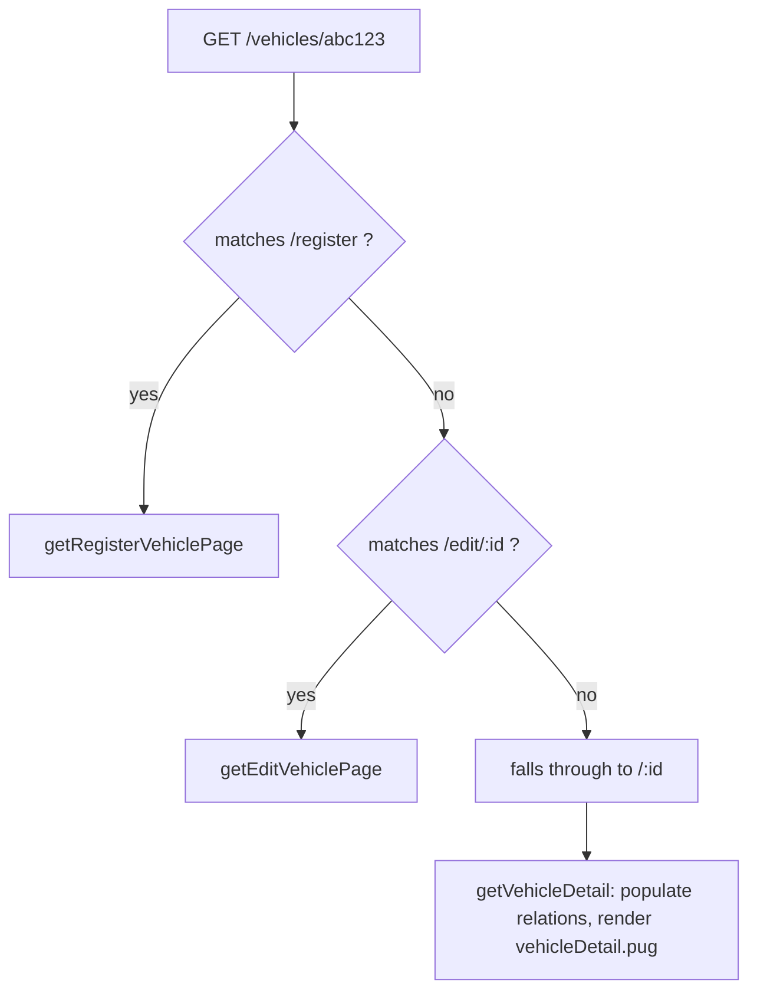

*Registration order in the router = match priority; `/:id` is registered last.*

**Why:** users needed to *inspect* a record without risking an accidental edit.
A separate read-only view is safer and can show richer context (history tables)
than an edit form.

### 8.3 Table search & filters

**What:** the search box on every list page (Vehicles, Customers, Services,
Technicians, Stock, Users) now actually filters the table as you type, and the
type/status dropdowns filter too. The "showing X of Y" footer updates.

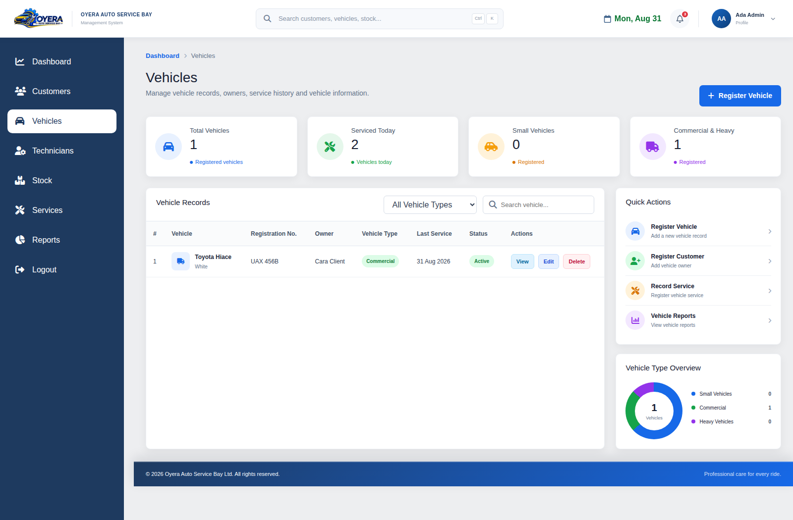

**How:** one reusable script, `public/js/tableSearch.js`. On load it finds each
`.card-panel`, reads its rows, and hides any row whose text (plus an optional
`data-filter` attribute) doesn't match the query and the active dropdown values.
It also pre-applies `?q=` / `?type=` from the URL, so a dashboard card can deep-link
into a filtered list.

**Why:** the search inputs were already in the markup but not wired to anything.
Client-side filtering is instant, needs no extra endpoints, and the datasets on
one page are small.

### 8.4 Clickable cards

**What:** the stat cards on the dashboard and every list page, and the "recent"
rows on the dashboard, are clickable and navigate to the relevant page (some with
a filter pre-applied, e.g. *Small Vehicles* → `/vehicles?type=small`).

**How:** `public/js/cardLinks.js` - any element with a `data-href` attribute
becomes a link (click + keyboard), while clicks on real buttons/links/forms
inside it are ignored so Edit/Delete still work.

**Why:** `data-href` + one delegated listener keeps the markup clean (no wrapping
every card in an `<a>`) and works for `<article>`, `<tr>`, anything.

### 8.5 Redesigned "Add Service" form

**What:** the old form used raw multi-selects ("hold Ctrl to pick several"). It
now uses **Tom Select**: the Customer, Services, Technicians and Parts fields are
searchable, and multi-selects show removable tag chips. The parts section, the
pricing guide and the total field were re-laid-out.

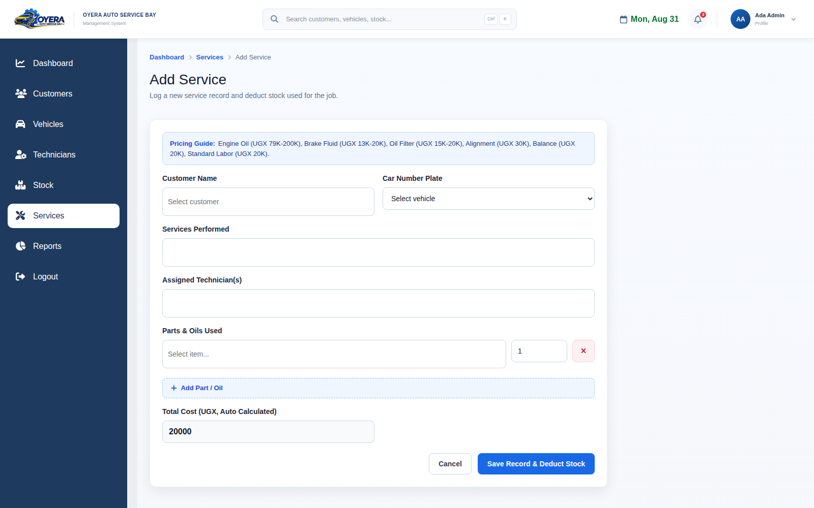

**How:** Tom Select is loaded from a CDN and attached to the existing `<select>`
elements. **The field `name`s, the options and the cost-calculation script were
not touched** - Tom Select keeps the underlying `<select>` in sync, so the form
submits exactly as before. The *Car Number Plate* field was deliberately left as a
native `<select>` because the "show only this customer's vehicles" cascade
manipulates its `<option>`s directly.

**Why:** a searchable component is essential once there are dozens of customers or
parts. Doing it via CDN + progressive enhancement means no build tooling and the
form still works if the CDN is unreachable.

### 8.6 Role changes for technicians

**What:** technicians are **view-only** on the Vehicles page (no add / edit /
delete), and they have **full access** to Services (add / edit / delete).

**How:** vehicle mutation routes moved from `isAuthenticated` to
`isAdminOrSeniorTechnician`; service routes moved the other way, to
`isAuthenticated`. The `permissions` object gained `canManageVehicles`, and the
Vehicles template hides the Register button and Edit/Delete controls when it's
false, showing only **View**.

**Why:** enforcing this in the route layer (not just hiding buttons) means a
technician can't reach the action by typing the URL either.

### 8.7 Responsive layout

**What:** the app is usable on a phone. Below ~1024px the fixed left sidebar
collapses into a horizontal scrolling nav strip and the content takes the full
width. Detail pages show the profile card **beside** the history cards on large
(17″) screens and **stacked** on smaller ones.

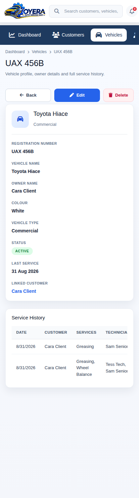
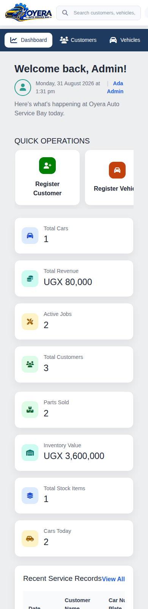

**How:** media queries in `layout.css` (sidebar) and `detail.css` (detail
layout). The sidebar rules use a slightly more specific selector
(`.main-container .side-bar`) so they win over the three page stylesheets that
each re-declare the sidebar.

**Why:** the sidebar had no responsive handling anywhere, which broke *every*
page on a narrow screen - fixing it once in the shared stylesheet fixed all pages.

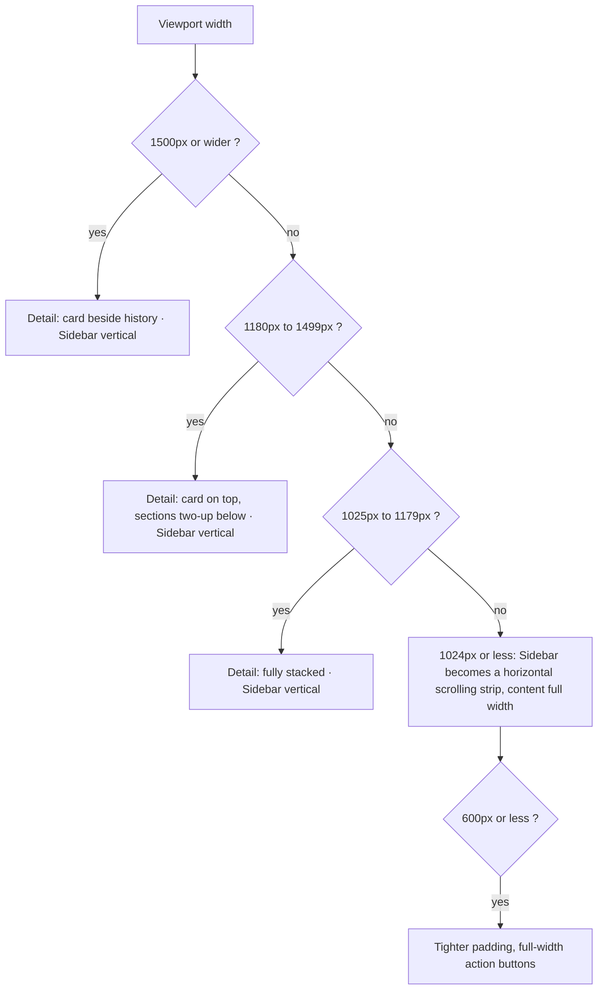

### 8.8 Scrollable dashboard tables

**What:** the two dashboard tables now scroll left/right on narrow columns,
matching the behaviour of the other list tables.

**How:** each table was wrapped in a `.table-responsive` container (the style
already existed in `dashboard.css`, it just wasn't used) and `.dashboard-card`
got `min-width: 0` so the inner scroll can actually engage inside the CSS grid.

---

## 9. Global search

`GET /search?q=…` (`searchControllers.globalSearch`) runs a case-insensitive
regex across customers (name/email, plus phone when the query is numeric),
vehicles (plate/name/type), stock (item name) and technicians (name), then
finds service records linked to any of those matches. Results render as cards
grouped by type, each linking to the relevant detail page.

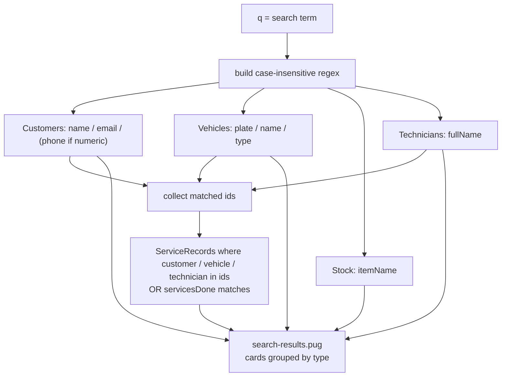

---

## 10. Running the project

### Prerequisites
- Node.js 18+
- A running MongoDB instance and its connection string

### Environment (`.env`, not committed)

```
DATABASE=<mongodb connection string>
SESSION_SECRET=<random string>
```

`DATABASE` is any MongoDB connection string (local instance or managed cluster),
including the database name. `SESSION_SECRET` signs the session cookie.

### Start

```bash
npm install
npm run dev     # nodemon, auto-restart on change
# or
npm start       # node index.mjs
```

The app serves on **http://localhost:3000**.

### First use

Create the first account at `/signup`, choosing its role. An **Admin** account
can then create and manage every other user from the Users page. Section 6
describes what each of the three roles (Admin, Senior technician, Technician) can
and cannot do.

---

## 11. Project structure

```
Oyera-Final-Project/
├── index.mjs                 app entry: middleware, route mounting, listen
├── db.mjs                    Mongoose connection
├── package.json
├── .env                      DB URL + session secret (git-ignored)
│
├── routes/
│   ├── authRoutes.mjs        signup, login, logout, user records + detail
│   ├── customerRoutes.mjs    /customers  (register, records, edit, delete, :id)
│   ├── vehicleRoutes.mjs     /vehicles   (+ role guards on mutations)
│   ├── serviceRoutes.mjs     /addRecord, /records, /records/:id …
│   ├── registerStockRoutes.mjs
│   ├── technicianRoutes.mjs
│   ├── dashboardRoutes.mjs
│   ├── reportsRoutes.js
│   └── searchRoutes.mjs
│
├── controllers/             one per resource + dashboard + reports + search
├── models/                  User, Customers, Vehicle, Stock, ServiceRecord
├── middleware/auth.mjs      isAuthenticated / isAdmin / isAdminOrSeniorTechnician
├── Validation/userValidation.mjs   input validation middleware
├── utils/                   passwordUtil (hash hook), flash (setFlash)
│
├── views/
│   ├── layout.pug           HTML shell: navbar, flash toast, page blocks
│   ├── partials/sidebar.pug permission-aware navigation
│   ├── dashboard.pug, vehicles.pug, records.pug, …   list & form pages
│   └── *Detail.pug          customer / vehicle / serviceRecord / technician / stock / user
│
├── public/
│   ├── css/                 layout.css, detail.css, + one file per page
│   ├── js/                  dashboard.js, tableSearch.js, cardLinks.js
│   └── images/
│
└── docs/screenshots/        images used in this document
```

---

## 12. Screenshots

| | |
|---|---|
| **Dashboard** - role greeting, quick operations, live KPI cards, recent activity | `docs/screenshots/dashboard.png` |
| **Vehicles list** - search, type filter, View / Edit / Delete per row | `docs/screenshots/vehicles-list.png` |
| **Service records list** | `docs/screenshots/records-list.png` |
| **Add Service** - Tom Select searchable fields, live total, stock deduction | `docs/screenshots/add-service.png` |
| **Vehicle detail** - profile card beside full service history (large screen) | `docs/screenshots/vehicle-detail.png` |
| **Customer detail** - profile + registered vehicles + job history | `docs/screenshots/customer-detail.png` |
| **Service record detail** - job breakdown + parts used | `docs/screenshots/service-detail.png` |
| **Stock detail** | `docs/screenshots/stock-detail.png` |
| **Flash message** - one-shot success toast after save | `docs/screenshots/flash-message.png` |
| **Mobile** - collapsed nav, stacked detail layout | `docs/screenshots/vehicle-detail-mobile.png`, `docs/screenshots/dashboard-mobile.png` |

---

## 13. Known limitations / next steps

- **Reports export** - reports are on-screen only; CSV/PDF export would help.
- **Notifications** - the navbar bell is currently static placeholder content.
- **Stock model duplication** - `models/Stock.mjs` is the live schema;
  `models/Stockk.mjs` is an unused earlier draft and can be removed.
- **Audit trail** - service edits reconcile stock correctly but don't keep a
  history of who changed what.
- **Payments** - a payments/invoicing module is stubbed in the permissions but
  not built.
